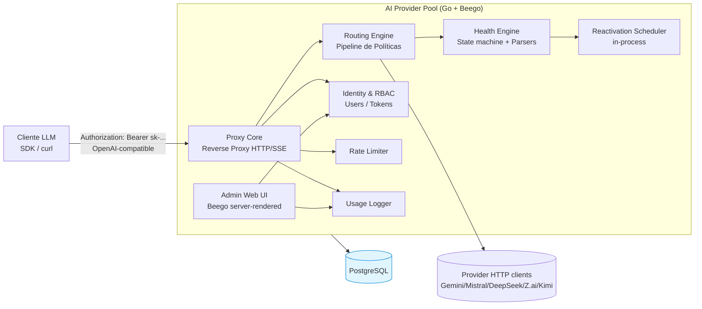

# Análise Arquitetural — AI Provider Pool (OpenAI-Compatible Proxy)

## 1. Contexto, Drivers e Premissas

### 1.1 Drivers de Negócio
- **Governança de acesso e segurança:** eliminar o compartilhamento informal de chaves via Telegram. Este é o driver nº 1 — qualquer decisão que enfraqueça a governança é um não-go.
- **Eficiência de cotas (cost-avoidance):** maximizar o aproveitamento dos saldos distribuídos entre chaves, evitando que membros fiquem sem tokens enquanto há saldo ocioso.
- **Resiliência transparente:** falhas de chave devem ser invisíveis ao cliente (failover automático).
- **Otimização de custo via cache de contexto:** afinidade de chave por conversa continua para reduzir recomputação de prefixo no provedor (economia real de tokens).

### 1.2 Premissas assumidas (validar com o time)
- Volume: **~30 usuários, baixo RPS agregado** (uso interativo de chat, não batch massivo). A arquitetura NÃO precisa ser otimizada para alto throughput — precisa ser otimizada para **corretude, resiliência e extensibilidade**.
- Implantação inicial: **1 réplica** em produção (single-instance). Horizontal scaling é uma preocupação de ROADMAP, não de MVP. Esta premissa tem impacto arquitetural forte (ver §7.3) e deve ser confirmada explicitamente.
- "OpenAI-compatible" significa o subconjunto `/v1/chat/completions` + `/v1/models` + streaming SSE — não a API inteira (assistants, embeddings, fine-tunes, etc.). É preciso **definir e documentar o contrato de compatibilidade**; perseguir compatibilidade total é um buraco sem fundo.
- As chaves de provedor são **credenciais sensíveis** e devem ser tratadas como secrets (criptografia em repouso, logs sem exposição).

### 1.3 Atributos de qualidade (priorizados)
1. **Segurança (confidencialidade das chaves, autenticação/autorização)** — inegociável.
2. **Disponibilidade/Resiliência** (failover transparente, auto-recuperação).
3. **Extensibilidade** (parsers, políticas de roteamento, novos provedores, ROADMAP).
4. **Manutenibilidade** (código claro, limites de módulo, testes).
5. **Observabilidade** (uso, auditoria, saúde das chaves).
6. **Performance** — apenas "suficiente" (baixa prioridade dado o volume).

---

## 2. Visão Arquitetural (C4 Nível Container)



**Limites claros (bounded contexts / módulos):**
- **Proxy Core** — única responsabilidade: receber requisição OpenAI-compat, fazer forward transparente (com streaming), devolver resposta. **Não conhece LRU nem failover** — delega ao Routing Engine.
- **Routing Engine** — seleciona qual `Key` usar dada a requisição. Implementado como **pipeline de políticas** (Chain of Responsibility). É a "costura" mais importante do sistema.
- **Health Engine** — máquina de estados das chaves (`active | cooling_down | manually_disabled | expired`), parsers de erro, scheduler de reativação.
- **Identity & RBAC** — usuários, tokens, roles, autenticação.
- **Persistence** — repositórios PostgreSQL (implementa interfaces do domínio — hexagonal).
- **Web/UI** — Beego controllers server-rendered (admin + dashboard).

---

## 3. Decisões Arquiteturais Críticas (irreversíveis / difíceis de refatorar)

A regra de ouro: **decisões que tocam o caminho quente do proxy (hot path) ou o modelo de dados central devem ser feitas corretamente no MVP**, mesmo que algumas features relacionadas fiquem para o ROADMAP.

### ADR-001 — Arquitetura hexagonal (ports & adapters) com núcleo de domínio puro

**Contexto:** O sistema tem muitos adapters (PostgreSQL, múltiplos provedores HTTP, web framework, futuro Redis/Prometheus/OAuth). Acoplamento direto entre lógica de negócio e infra torna mudanças caras.

**Decisão:** Núcleo de domínio em `/internal/domain` sem dependências externas (apenas tipos e interfaces). Casos de uso em `/internal/application`. Adapters (repositórios, HTTP clients, Beego) dependem do domínio, nunca o contrário.

**Consequências:** (+) Testabilidade máxima (domínio testável sem DB/HTTP). (+) Troca de PostgreSQL→outro, ou in-memory→Redis fica isolada. (−) Mais boilerplate/interfaces. (−) Disciplina necessária.

**Alternativas consideradas:** MVC tradicional do Beego (acoplado ao framework) — **rejeitado**: dificulta teste do hot path e prende a lógica ao ORM/controller.

---

### ADR-002 — Routing Engine como pipeline de políticas composável

**Contexto:** Hoje: LRU + afinidade de contexto + failover same-provider. Amanhã (ROADMAP): modelo "auto", failover cross-provider, quotas, limitação de horário, health-check probes. Se o roteamento for uma função monolítica, cada nova regra é uma reescrita do hot path.

**Decisão:** Modelar o roteamento como um **pipeline ordenado de políticas**. Cada política implementa uma interface:

```
type RoutingPolicy interface {
    // Decide se seleciona/marca/checa algo; pode short-circuit, passar adiante, ou vetar.
}
```

Pipeline MVP (ordem):
1. `HealthFilter` — exclui chaves em `cooling_down`/`manually_disabled`.
2. `AffinityPolicy` (cache de contexto) — se houver chave "sticky" para este user+prefix, propõe-a (best-effort).
3. `LRUPolicy` — seleciona a chave menos usada recentemente entre as elegíveis.
4. `FailoverPolicy` (orquestrado externamente ao pipeline, mas como conceito da mesma camada) — itera tentativas com backoff exponencial.

Políticas FUTURAS encaixam-se sem tocar as existentes: `QuotaPolicy`, `SchedulePolicy` (horário), `CapabilityPolicy` (modelo multimodal → roteamento "auto"), `TeamScopedPolicy` (isola chaves por time).

**Consequências:** (+) ROADMAP vira "adicionar policy", não "reescrever roteador". (+) Cada policy é testável isoladamente. (−) Ordem importa e pode ter interações sutis — documentar precedência explicitamente. (−) Pequeno overhead de abstração (irrelevante ao volume do projeto).

**Alternativas consideradas:** Função monolítica com `if`/`switch` — **rejeitado**: Explosão de complexidade no primeiro item do ROADMAP.

> ⚠️ **Esta é a decisão nº 1 de extensibilidade. Refatorar depois = reescrever o hot path em produção.**

---

### ADR-003 — Entidades de domínio de primeira classe: Provider, Key, Model como conceitos distintos

**Contexto:** Roadmap traz: model aliasing (`gpt-4` → modelo interno), roteamento "auto" baseado em capacidades (multimodal, janela de contexto), failover cross-provider (que exige saber a janela de contexto de cada modelo para não truncar), times com coleções de provedores.

**Decisão:** Modelar **desde o MVP**:
- `Provider` (id, nome, base_url, default headers, parser de erro associado, capability flags).
- `Key` (id, provider_id, encrypted_secret, user_agent_override, estado, métricas, owner_scope nullable).
- `Model` (id, provider_id, external_name, aliases[], context_window, modalities[], cost_per_1k_input/output nullable) — **mesmo que aliases/modalities/custo fiquem nulos no MVP**, o *esquema* deve existir.

**Por que agora:** adicionar `Model` como entidade depois que o código assume "model é só uma string" força refator em roteamento, logging, dashboard e UI. Adicionar `owner_scope` (tenant/team) depois exige migração em todas as tabelas que referenciam chave.

**Consequências:** (+) ROADMAP de aliasing/auto-routing/teams/quota-custo vira povoamento de dados, não refator. (+) Logging de uso fica rico desde o início. (−) Schema levemente maior no MVP. (−) Exige disciplina para não acoplar过早 funcionalidades (ter o campo não significa implementar a feature).

**Alternativas:** "Key com campos provider_name e model_name como strings" — **rejeitado**: empurra a dívida técnica para o primeiro item do ROADMAP.

---

### ADR-004 — Placeholder de multi-tenancy desde o MVP (coluna `tenant_id`)

**Contexto:** Multi-tenancy/organizações está explicitamente no ROADMAP. O domínio é, por natureza, "quem pode usar o quê" — tenant é uma dimensão central. Adicionar `tenant_id` em dezenas de tabelas depois (users, tokens, providers, keys, usage, ...) é caro e propenso a bugs de isolamento esquecidos.

**Decisão:** **Trade-off honesto a apresentar ao time — duas opções:**

- **Opção A (recomendada):** Introduzir `tenant_id NOT NULL DEFAULT <default_org_id>` em todas as tabelas relevantes, com UMA organização "default" no MVP. Queries já filtram por tenant (mesmo que sempre default). Isolamento lógico fica quase "de graça" depois.

- **Opção B:** Não introduzir agora; criar ADR documentando que migração para multi-tenant será um projeto dedicado no futuro (com rewrites de queries e risco de leakage).

Recomendo **Opção A** com ressalva: NÃO implementar UI/Admin de organizações nem isolamento forçado de dados no MVP — apenas ter a coluna, defaultar e propagar via contexto de requisição. Isto é o padrão "tenant column from day one" bem estabelecido.

**Consequências:** (+) Migração futura de multi-tenancy é incremental, não big-bang. (−) Pequeno overhead de design no MVP. (−) Risco de dar falsa sensação de isolamento — documentar que queries DEVEM sempre filtrar por tenant.

---

### ADR-005 — Error Parsers como registry de estratégias por provedor

**Contexto:** Parsing de mensagens de erro para extrair data de liberação de cota é **frágil e varia por provedor** (cada um tem formato, locale e estrutura próprios). Misturar regexes por provedor em um `switch` vira pesadelo de manutenção.

**Decisão:** Interface de domínio:

```
type ErrorParser interface {
    // Recebe (provider, statusCode, errorBody) e retorna um diagnóstico estruturado.
    Parse(ctx, err Response) ParsedError
}

type ParsedError struct {
    Kind            ErrorKind   // rate_limited | quota_exhausted | auth_invalid | transient | unknown
    ReactivateAt    *time.Time  // nil se não souber (entra em backoff genérico)
    ShouldDisable   bool
    Reason          string
}
```

- Registry `map[providerID]ErrorParser`, registrados em init.
- Fallback `DefaultErrorParser` (heurísticas genéricas: status 429, "rate limit" no corpo, regex de data ISO/genérico).
- Adicionar suporte a um novo provedor = criar um arquivo de parser e registrar — sem tocar o Health Engine.

**Consequências:** (+) Adição de provedor é cirúrgica. (+) Testes unitários por parser (fixtures de erro real por provedor). (+) Parsers podem evoluir (versão do provedor muda formato) isoladamente. (−) Coleta inicial de exemplos de erro reais por provedor (necessário de qualquer forma).

**Alternativas:** Switch gigante centralizado — **rejeitado**: violação de OCP, difícil de testar.

---

### ADR-006 — Afinidade de cache de contexto como política best-effort, in-memory, com TTL

**Contexto:** O diferencial do produto. Mas é uma **heurística**: a API OpenAI é stateless, não há session ID — a continuidade de conversa é **inferida** por detecção de prefixo (a mensagem atual contém a anterior no início). 

**Decisão:**
- Componente `ConversationAffinityResolver`, **separado do LRU** (é uma política distinta no pipeline, executada antes do LRU).
- Mantém cache em memória: `map[affinityKey]stickyKeyID` com TTL e tamanho limitado (LRU eviction).
- **`affinityKey` = hash滚动 do conteúdo das mensagens** (rolling hash das primeiras N mensagens — barato, O(n) com n pequeno). Estratégia sugerida: hash incremental do conteúdo concatenado dos primeiros K turnos; comparar prefixo.
- **Best-effort:** se a chave sticky estiver em `cooling_down`, cai para LRU normalmente (não bloqueia). Se o hash não bater (conversa reestruturada pelo cliente), simplesmente não há afinidade.
- Estado **efêmero**: perde-se em restart (apenas perda de otimização, sem perda de corretude).

**Modelagem arquitetural:**
- Reside em `/internal/routing/policies/affinity`.
- Expõe métricas/logs (hit/miss) — observabilidade é importante porque é um diferencial: precisamos saber se está funcionando.
- **Trade-off crítico a documentar:** em deploy multi-réplica (K8s), a afinidade **NÃO é compartilhada entre pods** sem um store externo (Redis). Para o MVP single-instance isto não importa, mas **deve estar no ROADMAP** com gatilho claro: "ao escalar para >1 réplica, mover affinity para Redis (ou sticky sessions via load balancer por user/token)".

**Consequências:** (+) Otimização real de custo. (+) Heurística tolerante a falhas. (−) Falsos positivos/negativos possíveis (documentar). (−) Não funciona cross-pod sem Redis (documentado).

**Alternativas consideradas:**
- Afinidade baseada em session-id custom header — **rejeitada**: quebra compatibilidade OpenAI (clientes não mandam session).
- Sem afinidade (só LRU) — **rejeitada**: perde o diferencial declarado do produto.

> ⚠️ **Decisão irreversível implícita:** o cache de afinidade NÃO pode residir dentro de uma request HTTP específica (precisa cruzar requests). Tem que ser um serviço de longa duração. Isto é trivial em Go (struct com mutex + map), mas **exige que o componente seja singleton na app**, não instanciado por request.

---

### ADR-007 — Proxy Core desacoplado do Beego; streaming via `httputil.ReverseProxy`-style handler

**Contexto:** Beego é um framework MVC pesado, com ciclo de vida de controller que pode **bufferizar resposta** — incompatível com streaming SSE de chat. O hot path do proxy precisa de controle fino de conexão, timeouts e flushing de chunks.

**Decisão:**
- O **Proxy Core** é um handler HTTP "puro" (não um Controller Beego) registrado em uma rota dedicada (ex.: `/v1/*`). Pode usar `httputil.ReverseProxy` configurado ou um handler custom com `http.Flusher`.
- **Beego** cuida exclusivamente de: admin CRUD, dashboard, auth de admin — onde MVC ajuda.
- Ambos convivem no mesmo binário/processo (Beego registra tanto as rotas admin quanto delega `/v1/*` ao proxy handler).

**Consequências:** (+) Streaming correto e performático. (+) Timeouts e connection pooling controlados por provedor. (+) Respeita a constraint "Go + Beego" sem ser refém dele no caminho quente. (−) Dois "estilos" de handler no mesmo app — documentar claramente qual rota usa qual.

**Alternativas consideradas:**
- Tudo via Controllers Beego — **rejeitado**: risco de buffering, lifecycle overhead no streaming.
- Trocar Beego por Gin/Echo — **rejeitado pela constraint** (mas registrada a recomendação técnica de que Gin/Echo seriam mais naturais para este perfil de app).

---

## 4. Decisões de Tecnologia — Confirmação e Challenges

### 4.1 Go — ✅ Confirmação integral
Linguagem ideal: concorrência leve, single binary, I/O eficiente, ecossistema maduro para proxies e HTTP. Sem reservas.

### 4.2 Beego — ⚠️ Aceito com ressalva (ver ADR-007)
Adequado para a camada admin/CRUD. **Não deve tocar o hot path do proxy.** Recomendação registrada: para um projeto greenfield deste perfil, **Gin, Echo ou chi+net/http** seriam mais naturais e idiomáticos. Como a constraint está dada, contorno via handler isolado. **Risco baixo** contanto que a separação seja respeitada.

### 4.3 PostgreSQL — ✅ Confirmação integral
- Usar `pgcrypto`/criptografia em nível de aplicação para chaves de provedor (envelope encryption com master key vinda de env/Secret K8s).
- Migrations obrigatórias desde o dia 1 (recomendo **golang-migrate**).
- JSONB para payloads de erro/log flexíveis.

### 4.4 Bibliotecas estratégicas (categorias — sem prescrever marca)
- **HTTP client:** `*http.Client` tunado por provedor (connection pool, timeouts específicos, `Transport`). Não usar `http.DefaultClient` (sem timeout).
- **Reverse proxy / streaming:** `net/http/httputil` + `http.Flusher`. Confirmar flush por chunk em SSE.
- **ORM/SQL:** avaliar **GORM** (ergonomia) vs **sqlc** (type-safe, gera código de SQL) vs **database/sql** puro. Recomendação: **sqlc ou GORM**; rejeitar o ORM do Beego (beego/orm) por acoplamento ao framework e menor adoção moderna. Decisão a ser tomada em especificação.
- **Migrations:** golang-migrate.
- **Logging estruturado:** **slog** (stdlib Go 1.21+). Rejeitar logger do Beego. Incluir request/trace ID correlacionado em todas as linhas.
- **Config:** 12-factor, env vars. `envconfig` ou `viper` (viper só se houver necessidade de múltiplas fontes — MVP: só env).
- **Password hashing:** `argon2id` (ou bcrypt aceitável). Nunca MD5/SHA cru.
- **Token generation:** `crypto/rand` (não `math/rand`).
- **Background scheduling:** in-process, goroutine + `time.Ticker` lendo uma fila `due_at` em memória para reativação de chaves. Para ROADMAP multi-instância → mover para Redis/queue.
- **Rate limiting:** in-process token bucket (ex.: `golang.org/x/time/rate`) por usuário/token. ROADMAP multi-instância → Redis.
- **(Futuro) Métricas:** `prometheus/client_golang`, exposto em `/metrics`. Preparar hook mas não implementar no MVP (exceto stub).
- **(Futuro) Graceful shutdown:** capturar SIGTERM, drenar conexões em flight com timeout. Implementar **já no MVP** pois é barato e o ROADMAP explicita — não esperar.

### 4.5 NÃO introduzir no MVP (YAGNI — mas arquitetar para slot fácil)
- **Redis:** seria natural para affinity/ratelimit/scheduler distribuído. MVP single-instance dispensa. Interfaces de domínio já isolam o store → troca futura é localizada.
- **Message broker:** desnecessário ao volume.
- **Service mesh:** desnecessário.

---

## 5. Modelagem de Dados de Alto Nível (entidades-chave)

Esboço conceitual (não é DDL — apenas para alinhar limites):

- `tenant` (id, name) — default seed no MVP.
- `user` (id, tenant_id, username UNIQUE per tenant, password_hash, role, active, created_at).
- `api_token` (id, user_id, token_hash UNIQUE — nunca guardar em claro, hashear; prefixo `sk-...` para UX, last_used_at, active).
- `provider` (id, tenant_id, name, base_url, default_headers jsonb, error_parser_kind, active).
- `provider_key` (id, provider_id, encrypted_secret, user_agent_override, state, last_used_at, usage_count, fail_count, cooldown_until, manually_disabled, created_at).
- `model` (id, provider_id, external_name, aliases jsonb, context_window, modalities jsonb, cost_in_per_1k, cost_out_per_1k, active).
- `usage_log` (id, tenant_id, user_id, token_id, provider_id, key_id, model_id, prompt_tokens, completion_tokens, latency_ms, status, error_kind, request_id, ts) — particional por tempo no futuro.
- `rate_limit` (config: per user/token, req/min).

**Notas de segurança:**
- `api_token` guardado **hasheado** (como senha). Comparação por hash. O valor `sk-...` é mostrado UMA vez na geração.
- `provider_key.encrypted_secret`: envelope encryption. Master key **nunca** no DB.
- Indices: `(user_id, ts)` em usage_log; `(provider_id, state)` em provider_key (hot path consulta chaves ativas por provider).

---

## 6. Fluxos Críticos — Considerações Arquiteturais

### 6.1 Fluxo de requisição (happy path)
```
Cliente → [Auth Middleware: valida Bearer token → resolve user/token]
        → [Rate Limiter: checa cota do token]
        → [Proxy Handler: parse body → extrai model + messages]
        → [Routing Engine:
             HealthFilter(chaves ativas do provider+model)
             → AffinityPolicy (tem sticky? sim → usa; não → continua)
             → LRU (escolhe menos usada)
          ]
        → [HTTP Client do provider: forward com streaming]
        → [Response: stream SSE de volta ao cliente, flushing por chunk]
        → [Usage Logger: registra (tokens quando disponível, status)]
```

### 6.2 Failover (erro em uma chave)
```
Tentativa na chave selecionada → erro
  → [ErrorParser provider-específico classifica]
     - Se auth_invalid/permanente → marca chave como disabled permanente + log
     - Se rate_limited/quota com data → cooldown_until = data + scheduler agenda reativação
     - Se transient/sem data → incrementa fail_count; se > threshold → cooldown com backoff
  → [FailoverPolicy: próxima chave do MESMO provider, MESMO modelo]
     - Backoff exponencial entre tentativas
     - Tenta TODAS as chaves ativas do provider antes de falhar
  → Se esgotou chaves → 503 com corpo OpenAI-compatible de erro
```

### 6.3 Streaming + failover — limitação fundamental
**Não é possível failover após o primeiro byte enviado ao cliente.** Estratégia:
- O loop de failover ocorre **antes de qualquer flush** ao cliente.
- Critério para considerar "sucesso": provider retornou status 2xx E começou a streamar (ou respondeu não-streaming completo).
- Erro APÓS início do stream → erro é **terminal**: devolver chunk de erro SSE ao cliente e encerrar. Não há retrocesso.

Isto deve ser documentado como **limitação aceita** do MVP.

### 6.4 Auto-disable / reativação
- `cooldown_until` é populado por parse de data OU por backoff.
- Scheduler (goroutine + ticker) periodicamente seleciona chaves com `cooldown_until <= now AND state=cooling_down` → reativa.
- Health-check periódico ativo (probe) fica no ROADMAP, mas a interface do Health Engine já deve prever `Probe(ctx, key)` para plugar depois.

---

## 7. Riscos Arquiteturais e Mitigações

### 7.1 Race conditions no estado de chave
Múltiplas requisições concorrentes podem simultaneamente marcar a mesma chave como falha, disparar failover storm, ou competir por LRU.

**Mitigação:**
- Estado de chave: **state machine com transições atômicas** (compare-and-swap no DB ou mutex in-memory + sync periódico).
- LRU counter: atomic.
- Curto-circuitar chaves `cooling_down` rapidamente (cache em memória) — não bater no DB a cada request.

### 7.2 OpenAI-compat surface imprecisa
Risco de escorregar para compatibilidade total com cada provider (que divergem em campos de usage, formato de erro, schemas).

**Mitigação:** Contrato de compatibilidade documentado: endpoints suportados, campos passados ipsis litteris, campos opcionais. Logging de divergências observadas. **Pass-through maximalista**: o proxy NÃO reescreve payloads de request (exceto User-Agent quando overridado); respostas são repassadas brutas.

### 7.3 Estado em memória vs. múltiplas réplicas K8s
Afinidade, rate-limit counters, cooldown cache, LRU — todos são **in-memory**. Em >1 réplica, divergem.

**Mitigação (crítica):**
- Documentar explicitamente que MVP é **single-replica** e que escalar horizontalmente exige:
  - Mover affinity/ratelimit/scheduler para Redis, OU
  - Sticky sessions no Ingress (por user/token) para afinidade, + Redis para os demais.
- Helm Chart configurado com `replicas: 1` por padrão, com comentário/alerta sobre as implicações.
- **Gateway readiness:** pods não devem receber tráfego até carregar cache inicial de estados de chave do DB.

### 7.4 Segredo de chave de provedor exposto
Risco: logar secret, vazar em erro, armazenar em claro.

**Mitigação:** Envelope encryption; redação em logs (mascarar); testes de "nenhum log contém o secret"; K8s Secret (não ConfigMap); rotação de master key contemplada no design.

### 7.5 Beego bufferiza streaming
Risco: experiência de chat quebrada (sem streaming real).

**Mitigação:** ADR-007 — proxy handler isolado, fora do controller Beego. **Teste de aceitação desde a fase de Proxy Core**: confirmar `curl -N` com `stream:true` recebe chunks em tempo real.

### 7.6 Dependência de exatidão de token counting
Providers nem sempre incluem usage em streaming, ou incluem em formato variável.

**Mitigação:** Preferir usage reportado pelo provider (parse do chunk final quando houver). Quando ausente, registrar como `tokens=NULL` (não estimar mal no MVP) e documentar. Estimativa opcional fica no ROADMAP.

### 7.7 Idempotência e retry do cliente
Cliente que reenvia mesma request após timeout de rede pode causar dupla cobrança no provider.

**Mitigação (MVP):** Aceitar e documentar. ROADMAP: suportar header de idempotency opcional.

---

## 8. Plano de Execução de Alto Nível (fases para o MVP)

Cada fase entrega valor demonstrável e testável isoladamente.

### Fase 0 — Fundações (1)
- Scaffold do repo Go module, layout de diretórios (clean/hexagonal), `.editorconfig`, linter (`golangci-lint`).
- `docker-compose.yml` (Postgres + app), `Makefile` (build/run/test/migrate).
- CI skeleton (lint + test).
- Setup de migrations (golang-migrate) + schema base (todas entidades do §5).
- Config loading (env), logging estruturado (`slog`) com request ID middleware.
- Health/readiness endpoints (`/healthz`, `/readyz`).

### Fase 1 — Núcleo de Domínio & Persistência (2)
- Entidades de domínio em `/internal/domain` + interfaces de repositório.
- Implementações PostgreSQL em `/internal/persistence`.
- **Camada de criptografia** para chaves de provedor (envelope).
- Migrations de todas as tabelas do §5.

### Fase 2 — Identidade & RBAC (3)
- Cadastro/login de usuário (senha argon2id), geração de `api_token` hasheado.
- Middleware de autenticação Bearer → resolve user/token; injeta no contexto.
- RBAC: roles `admin`/`user`. Middleware de autorização por rota.
- Seed de admin inicial.

### Fase 3 — Proxy Core (caminho quente) (4) ← *validação crítica*
- Handler HTTP isolado (não-Beego) para `/v1/chat/completions` e `/v1/models`.
- Reverse proxy com **streaming SSE** (`http.Flusher`); teste de `curl -N` em tempo real.
- HTTP client por provider (timeouts, pool, User-Agent override).
- Forward para **uma chave fixa** (sem balancing ainda) — provar end-to-end.
- Logging de uso básico (status, latência).

### Fase 4 — Routing Engine (5)
- Framework de pipeline de políticas.
- `HealthFilter`, `LRUPolicy`.
- `FailoverPolicy` same-provider com backoff exponencial.
- Semântica "failover só pré-primeiro-byte" para streaming.
- Estado de chave em memória + sync DB.

### Fase 5 — Health Engine & Parsers (6)
- Máquina de estados de chave (`active|cooling_down|manually_disabled`).
- `ErrorParser` interface + registry + `DefaultErrorParser`.
- ≥1 parser provider-específico (ex.: Gemini com data de liberação) usando fixtures reais.
- Auto-disable por threshold de erros + backoff.
- **Scheduler de reativação** (goroutine + ticker, lê `cooldown_until`).
- Toggle manual admin (force enable/disable).

### Fase 6 — Afinidade de Cache de Contexto (7) ← *diferencial*
- `ConversationAffinityResolver` (rolling hash, LRU in-memory com TTL).
- Integração como política no pipeline (antes do LRU).
- Observabilidade: log hit/miss, métrica (stub Prometheus opcional).
- Documentação da heurística e limitações.

### Fase 7 — Rate Limiting & Governança (8)
- Middleware rate limiter por user/token (token bucket in-process).
- Configurável (req/min).

### Fase 8 — Observabilidade de Uso (9)
- Logging estruturado completo de uso (tokens quando disponíveis, error_kind, request_id).
- Endpoints de consulta para dashboard (agregações).

### Fase 9 — Web UI (Admin + Dashboard) (10)
- Beego server-rendered (recomendado: server-rendered com templates — SPA é overkill para ~30 usuários; trade-off a confirmar com frontend specialist).
- CRUD: providers, keys (com máscara de secret), users, tokens.
- Dashboard: gráfico de utilização por usuário.

### Fase 10 — Hardening & Deploy (11)
- **Graceful shutdown** (SIGTERM, drenagem com timeout) — desde já (ROADMAP pede, custo baixo).
- Helm Chart (replicas: 1 com comentário), probes, resources, SecurityContext (runAsNonRoot, readOnlyRootFilesystem), Secrets.
- `/metrics` Prometheus stub (estruturado para crescer).
- Auditoria de segurança (secrets nunca logados, authz em toda rota mutante, headers de segurança).
- Testes de carga leve (confirmar streaming + failover sob concorrência).
- Documentação: README, ROADMAP.md, ADRs em `/docs/adr/`, AGENTS.md do projeto.

**Marcos de demonstração:**
- Após Fase 3: cliente OpenAI SDK funciona via proxy com streaming.
- Após Fase 5: failover e auto-reativação demonstráveis.
- Após Fase 9: MVP usável no dia a dia da equipe (critério de sucesso do briefing).

---

## 9. Pontos a Esclarecer / Decisões Deferidas

1. **Política exata de LRU:** por contador de uso? por `last_used_at`? LRU estrito ou aproximado? (Deferir para especificação de routing.)
2. **Hash de afinidade — granularidade:** hash por mensagem inteira, por turnos, por primeiras N? Trade-off precisão vs. custo. (Deferir, mas recomendo rolling hash incremental das primeiras K mensagens.)
3. **ORM:** GORM vs sqlc vs database/sql — decisão técnica a tomar em SPEC.
4. **Server-rendered vs SPA para UI** — trade-off; inclinar-me para server-rendered Beego, mas defiro a frontend specialist.
5. **Política de retenção de `usage_log`** (cresce indefinidamente) — particionamento/arquivamento no ROADMAP.
6. **Política de rotação de `api_token`** e invalidação imediata em multi-pod (in-memory cache de tokens válidos) — relevante se >1 réplica.
7. **Contrato de erros devolvidos ao cliente** em formato OpenAI-compatible — especificar shape exato.

---

## 10. Self-Check (verificação conforme princípios do arquiteto)

1. ✅ Toda decisão arquitectural traça de volta a um driver de negócio ou atributo de qualidade (governança, resiliência, custo, extensibilidade).
2. ✅ Alternativas apresentadas com trade-offs honestos em cada ADR (incluindo Beego vs alternativas, Opção A vs B de multi-tenancy).
3. ✅ Migração/caminho de evolução realista: phased, cada fase entrega valor, single-replica explícita.
4. ✅ ADRs com contexto, decisão, consequências, alternativas e status implícito (Proposed).
5. ✅ Engenheiro sênior externo conseguiria entender o "porquê" de cada decisão pela documentação.

---

## Resumo Executivo para o Manager

As **decisões estruturantes irrecuperáveis** são: (1) Routing Engine como **pipeline de políticas composável** — sem isto, o ROADMAP vira rewrite; (2) **Provider/Key/Model como entidades de primeira classe** — habilita aliasing, roteamento "auto", teams; (3) **tenant_id placeholder desde o MVP** — migração multi-tenant incremental vs big-bang; (4) **Proxy Core isolado do Beego** com streaming via handler puro — senão chat quebra; (5) **ErrorParser registry** — senão parsing vira pesadelo. A **afinidade de cache de contexto** deve ser modelada como política best-effort in-memory (documentando que multi-pod exige Redis). Confirmação integral de **Go + PostgreSQL**; **Beego aceito com ressalva** (admin/UI sim, hot path não). Plano de execução em 11 fases com marcos de demonstração claros, single-replica explícito, e graceful shutdown já no MVP.