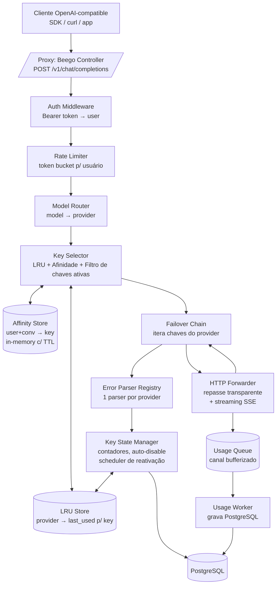

# Analysis: Backend Architect — Turn 1

**Agent ID:** software-development-backend-architect
**Timestamp:** 2026-06-25T18:49:59.451Z

# Análise de Arquitetura — Núcleo do Proxy (Backend Architect)

Projeto: **AI Provider Pool — OpenAI-Compatible Proxy** (Go + Beego + PostgreSQL)
Foco: **mecânica do proxy, LRU, afinidade de cache de contexto, failover, auto-disable, rate limiting, registro de uso, estrutura do projeto, riscos.**

---

## 1. Estado Atual e Pressupostos

Projeto **greenfield**. Não há código prévio, débito técnico, nem acoplamento a sistemas legados. Isso é uma vantagem: podemos estabelecer fronteiras de bounded contexts desde o início. As restrições (Go, Beego, PostgreSQL, Docker Compose para dev, Helm para prod) são **fixas e justas**; não vou propor alternativa.

**Pressupostos técnicos** que devem ser confirmados com os pares/usuário, mas que adoto como hipótese de trabalho:

- **P1**: Os provedores citados (DeepSeek, Mistral, Z.ai, Kimi) oferecem endpoints **nativos compatíveis com OpenAI** (`/v1/chat/completions`). O Gemini expõe uma API própria, mas tem um modo "OpenAI-compatible" via endpoint `generativelanguage.googleapis.com/v1beta/openai/`. Concluo: **todo provedor é consumido via schema OpenAI**, sem tradução de payload no MVP.
- **P2**: O `model` enviado pelo cliente identifica **univocamente** um provedor (ex.: `deepseek-chat` → DeepSeek). Modelos com mesmo nome em provedores distintos são desambiguados por tabela `model→provider`. O futuro "Model aliasing" é um pré-mapping transparente, não muda a mecânica.
- **P3**: Volume é baixo (~30 usuários, ~25 chaves no total). **O caminho crítico é latência percebida pelo usuário final**, não throughput. Decisões que otimizam CPU/throughput em detrimento da clareza são rejeitadas.

---

## 2. Visão Arquitetural Geral (Núcleo)



A separação entre **Selector** (decide QUAL chave), **Chain** (orquestra TENTATIVAS), **Forwarder** (faz o REPACE HTTP) é intencional: cada um tem responsabilidade única e pode ser testado isoladamente.

---

## 3. Mecânica do Proxy OpenAI-Compatible (Repasse Transparente)

### 3.1 Princípio fundamental

**Repasse transparente** = o proxy não interpreta nem reescreve o payload do provedor. Ele:
1. Recebe `POST /v1/chat/completions` (e companhias: `/v1/completions`, `/v1/embeddings`, `/v1/models`).
2. Autentica o token **do proxy** (não do provedor).
3. Decisões de roteamento usam apenas **inspeção de campos** do payload (não transformação).
4. Encaminha ao upstream **com os bytes originais do body**, trocando apenas `Authorization` (chave do provedor) e `User-Agent` (se override configurado).

### 3.2 Decisão: inspecionar, mas repassar bytes originais

Existem duas estratégias para o body:

| Estratégia | Vantagem | Desvantagem |
|---|---|---|
| **A. Parsear → decidir → re-serializar** | Permite normalizar | Risco de alterar bytes (espaços, ordem de keys) e quebrar cache de contexto do provedor; custo de CPU |
| **B. Ler em memória → decidir com parse parcial → repassar bytes originais** | Zero alteração no payload, cache do provedor preservado | Ocupa RAM (trivial: conversas de LLM raramente passam de 100–500 KB) |

**Recomendação: Estratégia B.** Ler o body em `[]byte`, fazer `json.Unmarshal` num struct parcial apenas com `{model, stream, messages, stream_options}` para decisões, e no repasse enviar os bytes originais. Mesmo payloads de 1 MB são triviais em Go (zero GC pressure com `sync.Pool` de buffers).

### 3.3 HTTP Client (configuração crítica)

Um **único** `http.Client` global (compartilhado, com connection pooling) configurado assim:

- `Transport.MaxIdleConnsPerHost`: alto (ex.: 100) — keepalive entre requisições.
- `Transport.IdleConnTimeout`: 90s.
- `Transport.ResponseHeaderTimeout`: ex.: 30s (tempo até o provedor enviar o primeiro byte/status). Esse é o "tempo de cabeça".
- **Sem `Client.Timeout` global** (que cobriria o body inteiro e mataria streaming longo). O controle de tempo é via `context.Context`.
- `TLSHandshakeTimeout`, `DialContext` com timeout curto (5–10s).
- `ForceAttemptHTTP2`: true (provedores suportam; reduz latência).

Cada requisição ao upstream recebe `context.WithTimeout(ctx, overallTimeout)` (ex.: 5 min para chat). Para streaming, este é o **overall cap**.

### 3.4 Streaming SSE (ponto de maior risco técnico)

Quando `"stream": true`, o provedor responde `Content-Type: text/event-stream`, `Transfer-Encoding: chunked`, com frames `data: {...}\n\n` terminando em `data: [DONE]\n\n`.

**Pipeline de streaming (goroutines + context):**

1. Criar `ctx, cancel := context.WithCancel(parentCtx)`; defer cancel.
2. Goroutine **upstream reader**: lê `bufio.Scanner` (com buffer ampliado — o default de 64 KB estoura em chunks grandes de LLM; usar `Scanner.Buffer` com ~1 MB ou `bufio.Reader` manual).
3. Cada frame lido é enviado a um canal `chan []byte` (ou escrito direto no ResponseWriter sob mutex).
4. Goroutine **downstream writer**: pega do canal, escreve `w.Write(...)`, `flusher.Flush()` imediatamente.
5. Encerrar quando: scanner encontra `[DONE]`, erro do upstream, `ctx.Done()` (cliente desconectou), ou idle timeout dispara.

**Configuração do ResponseWriter do Beego:**
- Setar headers ANTES do primeiro Write: `Content-Type: text/event-stream`, `Cache-Control: no-cache`, `Connection: keep-alive`, `X-Accel-Buffering: no` (desabilita buffering do nginx/reverse-proxy na frente).
- Obter `http.Flusher` do writer. Se não implementar Flusher → erro de configuração.
- **Não usar `Controller.ServeJSON`** do Beego (bufferiza). Escrever direto no `ResponseWriter`.

**Timeouts de streaming (três camadas):**
- **First-byte timeout** (ex.: 30s): se o provedor não enviar o primeiro chunk, failover.
- **Idle timeout** (ex.: 60s): entre chunks consecutivos. Se o provedor "trava" em meio ao stream, abortar.
- **Overall timeout** (ex.: 5–10 min): limite absoluto.

**Detecção de erro em meio ao stream:** Se o primeiro `data:` frame contém `{"error": ...}`, o provedor retornou 200 com erro no corpo (alguns fazem isso). Detecção: se status é 200 mas o primeiro frame é parseável como erro, propagar. **Pós-primeiro-chunk-usável, qualquer erro upstream vira erro para o cliente — não há failover transparente possível** (já comprometemos o stream do cliente).

### 3.5 Cancelamento pelo cliente

`r.Context().Done()` dispara quando o cliente fecha a conexão. **Obrigatório propagar** para o `ctx` do upstream — caso contrário, o proxy continua puxando tokens do provedor (custo!) numa conversa que o usuário abandonou. Implementação: o `parentCtx` do forwarder é `r.Context()`. Ao detectar `ctx.Err() != nil`, cancelar o request upstream.

### 3.6 Tratamento de Headers

- **Repassar**: `Content-Type`, `Accept`, `Accept-Encoding` (com cuidado: se o provedor comprime e o cliente pediu gzip, o proxy precisa ou descomprimir para inspeção ou repassar opaco — no MVP, **desabilitar Accept-Encoding no upstream** e streamar texto puro, simplifica debugging e inspeção).
- **Substituir**: `Authorization: Bearer <provider_key>`.
- **Override condicional**: `User-Agent` se configurado por provider/chave.
- **Remover**: `Host` (Go acerta), `Connection`, `Keep-Alive`, `Proxy-Authenticate`, `TE`, `Trailer`, `Transfer-Encoding`, `Upgrade` (RFC 7230 hop-by-hop).
- **Adicionar**: `X-Forwarded-For` não é relevante para o provedor, mas o proxy pode logar.

---

## 4. Load Balancing LRU Entre Chaves

### 4.1 Algoritmo

LRU (Least Recently Used) entre as chaves ativas de um provider:

1. Para o provider escolhido pelo Model Router, obter lista de chaves `active` e não em cooldown.
2. Selecionar a com menor `last_used_at`.
3. Marcar `last_used_at = now` **antes** de chamar (para que requisições concorrentes vejam a próxima).
4. Se a requisição falha com erro contável → o contador de erros da chave sobe (ver §6); se a chave for desabilitada, ela sai do pool.

### 4.2 Estrutura de dados

Para ~5 providers × ~5 chaves = ~25 chaves, qualquer estrutura é suficiente. Escolho **simplicidade**:

- **Por provider**: `map[keyID]time.Time` (last_used) + `sync.Mutex`.
- Seleção: iterar o map, achar o menor. O(n) com n≤5 é O(1) na prática. Min-heap é over-engineering.
- Não usar `container/list` (LRU clássico) porque **não há eviction** — só queremos o mínimo.

### 4.3 Concorrência e atomicidade

Com 30 usuários em simultâneo:
- Mutex por provider (granularidade boa, sem contenção relevante).
- Race entre duas requisições pegando a mesma chave é **benigno** — LRU é heurística de distribuição, não exclusividade. Mesmo que duas peguem a chave menos recente, a terceira já verá a segunda menos recente.

### 4.4 Quando atualizar last_used

**Decisão: atualizar no momento da seleção (antes da chamada).** Justificativa:
- Se atualizarmos só após sucesso, requisições simultâneas todas batem na mesma chave (last_used ainda antigo).
- Se a chamada falha e a chave não é desabilitada, ela só fica momentaneamente "recente"; o mecanismo de auto-disable (§6) cuida das chaves realmente ruins.

### 4.5 Persistência

**LRU é heurística pura — não persistir.** Razões:
- Reinício do proxy redistribui a carga, o que é aceitável.
- Evita round-trips em PostgreSQL no caminho crítico de seleção.
- O cache de contexto do provedor é mantido por ele (por chave), independente do estado interno do proxy.

**Observação importante para o futuro (ROADMAP / K8s multi-réplica):** LRU em memória não é compartilhado entre réplicas. Cada réplica terá visão parcial. Para o MVP com 1 réplica, sem problema. Documentar como evolução → Redis para estado compartilhado.

---

## 5. Afinidade de Cache de Contexto (Diferencial do Produto)

### 5.1 O problema em profundidade

Provedores de LLM (especialmente DeepSeek com `deepseek-reasoner`, Gemini com contexto cacheado, Anthropic) mantêm **cache de K/V attention** em server-side. Se você envia exatamente os mesmos tokens de prefixo em chamadas subsequentes, a inferência é mais barata e rápida. **O cache é POR CHAVE DE API** (ou por projeto/org). Conclusão: para aproveitar o cache, devemos rotear **a continuação de uma conversa para a MESMA chave do MESMO provedor** usada na requisição anterior.

### 5.2 Definição precisa de "continuidade de conversa"

Seja `M_prev = [m_1, ..., m_k]` (array de mensagens da requisição anterior) e `M_curr = [m_1', ..., m_n']` (array atual). Há continuidade **se e somente se**:

- `n > k` (o array atual é estritamente maior), **E**
- `M_prev` é prefixo exato de `M_curr`: `∀ i ≤ k: m_i ≡ m_i'` (após normalização canônica).

**Não há continuidade** quando:
- `n == k` com arrays idênticos: é **repetição** (o usuário reenviou a mesma pergunta). Não rotear para a mesma chave — pode ser novo uso, queremos LRU.
- `n < k`: anomalia (cliente truncou histórico). Ignorar afinidade, ir LRU.
- Prefixo casa mas `n > k` porém com intercalação diferente: não casa.

### 5.3 Identificação da "tarefa/conversa"

A API OpenAI nativa **não tem** ID de conversa. Estratégia híbrida:

**Opção 1 (recomendada para MVP): ID opcional via header**
- Se o cliente enviar `X-Conversation-ID: <string>` (ou `X-Session-ID`), usamos diretamente.
- Mapeamento: `(user_id, conversation_id) → {provider_id, key_id, prefix_hash, message_count, last_seen}`.
- O cliente (a aplicação que chama o proxy) é responsável por gerar o ID. Simples, determinístico.

**Opção 2 (fallback heurístico): hash do prefixo**
- Sem `X-Conversation-ID`, calcular `hash(M_curr[0..n-1])` (ou das últimas K mensagens) e procurar entrada correspondente.
- Mantém uma "janela" de hashes recentes por usuário.
- Mais complexo, suscetível a falsos positivos (perguntas idênticas).

**Decisão: Implementar Ambas.** Opt-in via header é trivial e determinístico; o hash heurístico cobre clientes que não enviam o header. Documentar que o header é o caminho preferido.

### 5.4 Hash do prefixo

- **Normalização antes do hash**:
  - Minify JSON (sem espaços).
  - Ordenar keys alfabeticamente em cada mensagem.
  - Considerar apenas `role` e `content` (e `tool_calls`/`name` quando existirem). Ignorar campos arbitrários do cliente.
- **Algoritmo**: SHA-256 truncado para 128 bits (32 hex chars). Sem risco de colisão relevante.
- **Janela**: hash das últimas K mensagens (ex.: K=20). Conversas muito longas não exigem hashar tudo.

### 5.5 Estrutura de dados (Affinity Store)

Por usuário, em memória, com TTL e limite:

```
affinityStore[user_id] = {
  conv_id (ou prefix_hash) → {
    provider_id,
    key_id,
    prefix_hash,         // hash atual (vira o prefixo da próxima requisição)
    message_count,       // n do array atual
    last_seen,           // para TTL
  }
}
```

- `sync.RWMutex` por usuário ou um único mutex global (30 usuários é trivial).
- **TTL**: ex.: 30 min sem uso → evict. Razão: o cache do provedor também tem TTL (~5–60 min tipicamente).
- **Limite por usuário**: ex.: 50 conversas em memória (LRU eviction das mais antigas).

### 5.6 Fluxo de decisão

Ao receber requisição:
1. Extrair `user_id`, `messages`, `conversation_id` (header ou derivado).
2. Hash de `messages` → `h_curr`. Hash de `messages[0..n-1]` (sem última) → `h_prefix`.
3. Buscar entrada por `(user_id, conversation_id)` (se houver ID) OU por `(user_id, h_prefix)` (heurística).
4. **Se encontrada E a chave ainda está ativa E o provider_key_id não está em cooldown**:
   - Roteia para essa chave.
   - Atualiza entrada: `prefix_hash = h_curr`, `message_count = n`, `last_seen = now`.
5. **Se não encontrada** (ou chave inválida):
   - Roteia LRU.
   - Cria/Atualiza entrada com a chave escolhida, `prefix_hash = h_curr`, `message_count = n`.

### 5.7 Edge cases críticos

| Caso | Comportamento |
|---|---|
| Primeira mensagem de uma conversa | Sem prefixo casando → LRU; cria entrada |
| Mensagens idênticas, usuários diferentes | Store é POR usuário → sem colisão |
| Mesmo usuário reenvia exatamente a mesma pergunta (`n == k`, arrays idênticos) | Não há continuidade (n não aumentou) → LRU |
| Cliente limpa histórico e recomeça | Novo hash, novo roteamento |
| Chave em afinidade foi desabilitada (auto-disable) | Tratar como "não encontrada" → LRU; atualizar entrada |
| Reinício do proxy | Store em memória perdida; recria conforme tráfego (aceitável) |
| Conversa longa (>50 msgs) | Hashar janela das últimas K=20, não o array inteiro |
| `tool_calls` complexos | Entram no hash (preserva identidade semântica) |

---

## 6. Cadeia de Failover Dentro do Provider

### 6.1 Erros que disparam failover

| Status / Tipo | Failover? | Auto-disable contável? | Justificativa |
|---|---|---|---|
| 400 Bad Request | **Não** | Não | Erro do cliente; outra chave terá o mesmo erro |
| 401 / 403 | **Sim** | **Sim (pesado, ex.: conta 2)** | Chave inválida/revogada |
| 404 (modelo) | **Não** | Não | Mesmo erro em todas as chaves |
| 408 / 504 / network / timeout | **Sim** | Sim (moderado) | Transiente |
| 409 | Caso a caso | Não | Raro em LLM; classificar por mensagem |
| 413 / 422 | **Não** | Não | Payload muito grande; mesmo problema |
| 429 | **Sim** | **Sim (moderado)** | Rate limit / quota |
| 5xx (500/502/503) | **Sim** | Sim (moderado) | Falha do provedor |
| Erro durante streaming (pós primeiro chunk útil) | **Não (erro final ao cliente)** | Sim (a chave falhou) | Não há transparência possível |
| `Retry-After` header presente | Respeitar se ≤ threshold (ex.: 60s); senão desabilitar com data | — | Ver §6.3 |

### 6.2 Ordem das tentativas

1. Chave escolhida pelo Selector (LRU ou afinidade).
2. Se falha com erro "failover": marca erro, pega a próxima chave ativa do **mesmo provider** (LRU das remanescentes).
3. Repete até esgotar chaves ativas do provider.
4. Esgotadas → retorna erro ao cliente com status apropriado (502 ou 503) e mensagem agregada (qual provider, quantas chaves tentadas).

**Sempre mesmo modelo**: o `model` do request original é preservado em todas as tentativas (failover é entre chaves, não entre modelos).

### 6.3 Backoff exponencial

Como failover é entre **chaves distintas**, o backoff é curto (não há sentido em esperar a mesma chave se recuperar):

- **Delay inicial**: 100ms.
- **Fator**: 2.
- **Cap**: 1–2s.
- **Jitter**: **full jitter** (`rand(0, delay)`), evita thundering herd se várias réplicas.
- **Sem delay na 1ª tentativa** (ir direto).

**Atenção ao `Retry-After`:** se o 429 trouxer `Retry-After: <segundos>` ou data, e for ≤ threshold (ex.: 60s), respeitar; caso contrário, usar o `Retry-After` como pista para auto-disable (ver §7).

### 6.4 Idempotência

Chamadas a LLM **não são idempotentes**. Cada tentativa a uma chave distinta gera tokens (potencialmente cobráveis) no provedor. Mas:
- Cada chave é uma cota diferente → o "custo" é diluído entre chaves (que é o objetivo do pool).
- Não há "double charge" no mesmo provedor/key que importe ao usuário.
- **Risco real**: timeout em meio ao stream → provedor já gerou tokens → nova tentativa gera mais. Aceitável no MVP (problema do provedor); documentar.

### 6.5 Detecção de erro vs resposta válida

- Status não-2xx no cabeçalho HTTP → classificar pelo código.
- Status 200 + body contendo `{"error": ...}` (alguns provedores) → parsear JSON do body, classificar pela `error.type` ou `error.code`.
- Status 200 + stream onde um frame é `data: {"error":...}` → propagar como erro ao cliente (não há failover transparente).

---

## 7. Auto-Disable com Parse de Data

### 7.1 Estado da chave (máquina de estados)

```
        ┌──────────┐  admin enable   ┌────────────┐
        │ DISABLED │ ───────────────▶│   ACTIVE   │◀────┐
        │  MANUAL  │                 │            │     │ auto-reactivate
        └──────────┘                 └─────┬──────┘     │ (disabled_until
              ▲                            │ N errors   │  atingido)
              │ admin disable              ▼            │
              │                      ┌────────────┐    │
              └──────────────────────│ DISABLED   │────┘
                                     │   AUTO     │
                                     │ until=T    │
                                     └────────────┘
```

Estados:
- `ACTIVE`: no pool, candidata a LRU.
- `DISABLED_AUTO`: desabilitada pelo sistema, `disabled_until` define reativação.
- `DISABLED_MANUAL`: desabilitada pelo admin, ignora `disabled_until`.

### 7.2 Contagem de erros

- Por chave: `consecutive_failures int`.
- Threshold configurável (ex.: 5).
- **Reset** para 0 em qualquer sucesso.
- Pesos por tipo de erro (401/403 conta mais, 429 conta moderado).

**Concorrência**: contador protegido por mutex atômico (`atomic.Int32` ou `sync.Mutex`).

### 7.3 Parser registry (extensível por provider)

Interface (apenas design, sem código):

```
ErrorParser {
  Parse(providerErrorResponse) → ParseResult {
    DisableUntil *time.Time   // data detectada (pode ser nil)
    IsFatal      bool          // chave irrecuperável (403 com "key revoked")
    Reason       string
  }
}
```

- **Registro**: `parserRegistry[provider_id] = Parser`.
- **Fallback genérico**: regex procurando padrões:
  - ISO 8601 / RFC 3339: `\d{4}-\d{2}-\d{2}T\d{2}:\d{2}:\d{2}(Z|[+-]\d{2}:\d{2})`.
  - Date solta: `\d{4}-\d{2}-\d{2}`.
  - Unix epoch: `\d{10}` em contexto "until" / "at".
  - Relativo: `in (\d+) (seconds?|minutes?|hours?|days?)`.
  - `Retry-After` header do HTTP.
- **Parsers por provider** (DeepSeek, Gemini, Mistral, Z.ai, Kimi) como arquivos separados em `internal/keymgmt/parsers/`. Adicionar um novo provider = adicionar um arquivo + linha de registro. Baixo acoplamento.

### 7.4 Reativação

**Duas camadas combinadas**:

1. **Persistência em PostgreSQL**: coluna `disabled_until TIMESTAMPTZ` na tabela `api_keys`. Sobrevive a restarts.
2. **Background scheduler**: goroutine com `time.Ticker(30s)` que faz `SELECT ... WHERE state='DISABLED_AUTO' AND disabled_until <= NOW()` e reativa.
3. **Lazy reativação (opcional, baixa latência)**: ao selecionar chaves para LRU, se uma `DISABLED_AUTO` tem `disabled_until <= now`, reativar on-the-fly.

**Não usar `time.AfterFunc` sozinho**: perde-se em restart do K8s. Combinar com persistência.

### 7.5 Fluxo completo de erro

1. Forwarder retorna erro classificado.
2. Chain incrementa contador de erros da chave.
3. Se contador ≥ threshold:
   - Chama parser apropriado.
   - Se parser retorna `DisableUntil`: `disabled_until = DisableUntil`, `state = DISABLED_AUTO`.
   - Se parser retorna `IsFatal`: `state = DISABLED_MANUAL` (requer intervenção).
   - Se parser retorna `nil` (sem data): backoff crescente (`disabled_until = now + {5min, 30min, 2h, 24h}` conforme contagem de ciclos de desabilitação).
4. Persistir em PostgreSQL (assíncrono via canal, não bloqueia o caminho do failover).
5. Scheduler reativa quando expira.

---

## 8. Rate Limiting por Usuário/Token

### 8.1 Algoritmo

**Token bucket** — permite burst controlado + média sustentada:
- Capacidade `B` (burst).
- Taxa de reposição `R` tokens/seg.

Vantagem sobre fixed/sliding window: smoother, sem bordas abruptas.

### 8.2 Granularidade

- Por **usuário** (recomendado para MVP — mais simples de gerenciar).
- Por **token** (mais granular; útil quando usuário tem tokens para diferentes apps).
- **Decisão**: implementar dos dois, default por usuário; admin pode configurar por token.

### 8.3 Armazenamento

- **MVP (1 réplica)**: in-memory. Estrutura: `map[userID]*bucket` com `sync.Mutex`. Refill preguiçoso (calculado no acesso).
- **Interface abstraída** (`RateLimiter`): a implementação concreta (`MemoryLimiter` / `RedisLimiter` futura) é injetada. Permite evolução sem tocar o middleware.

### 8.4 Resposta em caso de excesso

- HTTP 429 com `Retry-After: <segundos>` calculado do bucket.
- Body JSON `{"error": {"type": "rate_limit_exceeded", "message": "..."}}` (estilo OpenAI).

---

## 9. Registro de Uso (Assíncrono)

### 9.1 Schema por requisição

| Campo | Origem |
|---|---|
| `id` (UUID) | Proxy gera |
| `ts` | Timestamp do fim da requisição |
| `user_id`, `token_id` | Auth |
| `provider_id`, `api_key_id` (ref indireta, sem expor valor) | Selector |
| `model` | Request |
| `request_tokens`, `response_tokens`, `total_tokens` | Provider response `usage` |
| `stream` (bool) | Request |
| `latency_ms` | Medido |
| `status_code` | Response final |
| `error_kind` (nullable) | Classificação |
| `failed_keys` (JSON array) | Chain (quais chaves falharam antes do sucesso) |

### 9.2 Captura de tokens

- **Não-streaming**: `response.usage` no JSON final.
- **Streaming**: último chunk pode conter `usage` (DeepSeek, OpenAI) **se** request trouxer `stream_options: {include_usage: true}`. Se cliente não enviou, tentar inserir essa opção no request upstream (repasse quase-transparente — adicionar campo no body). Se provedor não suporta `usage` em stream → campo fica NULL.
- **Parsing robusto**: o proxy lê o último frame e tenta extrair `usage`. Em caso de ausência, registra NULL (não falha).

### 9.3 Assincronia

- Canal bufferizado `chan UsageRecord` (ex.: capacidade 1000).
- Após responder ao cliente (ou finalizar erro), **non-blocking send** com `select` + default → se canal cheio, logar localmente (stderr) e descartar (preferível a bloquear o cliente).
- Worker goroutine consome o canal, **batch insert** em PostgreSQL (ex.: 50 records ou 500ms, o que vier primeiro). Reduz round-trips.
- **Indexes**: `(user_id, ts DESC)`, `(api_key_id, ts DESC)`, `(ts)`.

### 9.4 Medição de latência

- Início: `t0 := time.Now()` ao receber a requisição.
- Fim: imediatamente após último byte enviado ao cliente (ou erro).
- Latência total reportada; para streaming, é o tempo até `[DONE]`. Opcionalmente capturar `time_to_first_token` separadamente (metric útil).

---

## 10. Estrutura do Projeto Go + Beego

### 10.1 Layout (Hexagonal / Ports & Adapters)

```
ai-pool/
├── cmd/ai-pool/main.go                  # entrypoint: roda Beego + workers
├── internal/
│   ├── config/                          # config (env + arquivo; viper)
│   ├── domain/                          # ENTIDADES + INTERFACES (sem Beego, sem DB)
│   │   ├── apikey.go
│   │   ├── provider.go
│   │   ├── user.go
│   │   ├── usage.go
│   │   └── errors.go
│   ├── proxy/                           # NÚCLEO DO PROXY
│   │   ├── handler.go                   # Controller Beego: /v1/chat/completions etc.
│   │   ├── forwarder.go                 # repasse HTTP + headers
│   │   ├── streamer.go                  # SSE streaming (goroutines, flush)
│   │   ├── model_router.go              # model → provider
│   │   └── selector.go                  # LRU + afinidade + filtro de chaves ativas
│   ├── balancing/
│   │   ├── lru.go                       # LRU store in-memory
│   │   └── affinity.go                  # Affinity store in-memory
│   ├── failover/
│   │   ├── chain.go                     # orquestra tentativas
│   │   ├── classifier.go                # status code → ação
│   │   └── backoff.go                   # backoff exponencial + jitter
│   ├── keymgmt/
│   │   ├── state.go                     # máquina de estados da chave
│   │   ├── scheduler.go                 # background reactivation
│   │   ├── registry.go                  # ErrorParser registry
│   │   └── parsers/
│   │       ├── generic.go               # fallback regex
│   │       ├── deepseek.go
│   │       ├── gemini.go
│   │       └── ...
│   ├── ratelimit/
│   │   ├── limiter.go                   # interface
│   │   └── memory.go                    # implementação in-memory
│   ├── usage/
│   │   ├── recorder.go                  # enfileiramento
│   │   └── worker.go                    # batch insert
│   ├── auth/
│   │   └── middleware.go                # Bearer token → user
│   ├── rbac/
│   │   └── roles.go
│   ├── repository/                      # ADAPTADORES PostgreSQL
│   │   ├── pgx/ ou sqlx
│   │   ├── apikey_repo.go
│   │   ├── provider_repo.go
│   │   ├── user_repo.go
│   │   └── usage_repo.go
│   ├── api/                             # Admin REST endpoints
│   │   └── controllers/
│   └── web/                             # Dashboard (TBD: templates Beego vs SPA)
├── migrations/                          # golang-migrate
├── configs/
├── deploy/
│   ├── docker-compose.yml
│   └── helm/
└── ROADMAP.md
```

### 10.2 Princípios

- **`domain/` é puro Go**: sem `beego`, sem `pgx`. Define structs + interfaces. Testável sem infra.
- **`repository/` implementa interfaces de `domain/`**: dependência aponta para dentro.
- **`proxy/`, `balancing/`, `failover/`, `keymgmt/`** são pacotes independentes que se conhecem só por interfaces.
- **Beego é um detalhe de transporte**: handlers em `proxy/handler.go` chamam serviços de domínio; se amanhã trocamos por `chi` ou stdlib, `domain/` não muda.

### 10.3 Considerações sobre Beego

- Beego v2 (active). Controllers via `beego.Controller` ou handlers via `web.Handler`. Para streaming manual, preferir handler direto no `ResponseWriter` (Beego suporta).
- Middlewares via `web.InsertFilter`.
- Não usar `beego ORM` (usar `pgx` direto — controle sobre performance e prepared statements).

### 10.4 Configuração e Secrets

- **Chaves de API**: criptografadas em PostgreSQL (AES-256-GCM), chave mestra via env (`AIPOOL_MASTER_KEY`). **NUNCA em plaintext.**
- **Tokens do proxy** (`sk-...`): armazenar **hash** (Argon2id ou bcrypt), como senhas. Versão legível mostrada só na criação.
- **Config** via env vars + arquivo opcional; `viper` ou `envconfig`.

---

## 11. Modelo de Dados (PostgreSQL) — Visão de Núcleo

Tabelas essenciais para o núcleo do proxy (RBAC/dashboard ficam com outros):

- `users` (id, username, password_hash, role, active, created_at).
- `api_tokens` (id, user_id, token_hash, prefix, last_used_at, active, created_at). `prefix` = primeiros 8 chars para identificação no dashboard sem expor.
- `providers` (id, name, base_url, auth_type, default_headers jsonb, user_agent_override, active).
- `api_keys` (id, provider_id, encrypted_key, label, state enum, disabled_until timestamptz, consecutive_failures int, created_at). `encrypted_key` AES-GCM.
- `provider_models` (id, provider_id, model_name) — quais modelos cada provider oferece (para roteamento).
- `usage_records` (id uuid, ts timestamptz, user_id, token_id, provider_id, api_key_id, model, request_tokens int, response_tokens int, total_tokens int, stream bool, latency_ms int, status_code int, error_kind text, failed_keys jsonb).

**Consistency**: PostgreSQL single-node no MVP (strong consistency). Não há necessidade de replicação lógica complexa para 30 usuários. Backup noturno é suficiente.

**Migrations**: `golang-migrate` com arquivos versionados em `migrations/`.

---

## 12. Riscos Técnicos e Mitigações

| # | Risco | Severidade | Mitigação |
|---|---|---|---|
| 1 | **Memory leak em goroutines de streaming** | Alta | `context.WithCancel` + defer cancel; timeouts obrigatórios; testes de leak com `goleak`; pprof em runtime |
| 2 | **Streaming pendurado por provider lento** | Alta | Idle timeout entre chunks (ex.: 60s); overall cap (ex.: 10min) |
| 3 | **Cliente desconecta e proxy continua puxando tokens** | Alta (custo!) | Propagar `r.Context().Done()` ao upstream; cancelar req |
| 4 | **Race: chave desabilitada entre seleção e uso** | Média | Aceitar (failover cobre); revalidar lazy se crítico |
| 5 | **Parser de erro quebrado por mudança no provider** | Média | Registry isolado; fallback genérico; testes de fixture por provider |
| 6 | **Falso positivo em afinidade** (conversa ID colidindo) | Média | Store é por `(user, conv_id)`; hash só como fallback; testes com fixtures |
| 7 | **State não compartilhado em multi-réplica K8s** | Média (futuro) | Documentar; interfaces abstraídas (`LRUStore`, `AffinityStore`, `RateLimiter`) para troca por Redis |
| 8 | **Body grande estourando RAM** | Baixa | `io.LimitReader` (ex.: 10MB); 413 se exceder |
| 9 | **Chaves expostas em logs** | Alta (segurança) | Logger com field-level redaction; nunca logar `encrypted_key` descriptografado |
| 10 | **Backpressure: providers lentos + fila cresce** | Média | Semáforo de concorrência global (ex.: 200 reqs em paralelo); 503 + Retry-After se exceder |
| 11 | **Duplo consumo de tokens em timeout mid-stream** | Baixa | Aceitável no MVP (problema do provider); documentar |
| 12 | **Beego buffering SSE** | Média | Não usar `ServeJSON`; escrever direto no `ResponseWriter` + `Flusher.Flush()` |
| 13 | **`bufio.Scanner` estoura buffer** | Média | `Scanner.Buffer(buf, 1<<20)` ou `bufio.Reader.ReadString('\n')` |
| 14 | **TLS do provider requer HTTP/2** | Baixa | `ForceAttemptHTTP2: true` no Transport |

---

## 13. Caminho de Evolução (preparar o futuro)

Decisões de design que **custam pouco agora** e pavimentam o ROADMAP:

- **Multi-réplica / estado compartilhado**: abstrair `LRUStore`, `AffinityStore`, `RateLimiter` como interfaces. Troca por Redis é cirúrgica.
- **Times / multi-tenancy**: coluna `tenant_id` (default null = "default") em todas as tabelas desde já. Não traz custo e elimina migration cara depois.
- **Quota de tokens**: a tabela `usage_records` já é agregável por `(user_id, ts)`. VIEW materializada ou rollup job.
- **Failover cross-provider**: o `failover/chain.go` pode evoluir para iterar primeiro mesmas chaves do provider (hoje) e depois providers equivalentes. Adicionar `provider_equivalence` (modelos equivalentes cross-provider). A janela de contexto variável é o desafio — registrar como alerta.
- **Roteamento "auto"**: o `model_router.go` hoje faz `model → provider`; amanhã pode decidir por heurística (anexo → multimodal). Mantê-lo isolado e testável.
- **Metrics Prometheus**: instrumentar com `prometheus/client_golang` desde o MVP (latência por provider, erros por chave, tokens por user). Barato, valor imediato para observabilidade.
- **Graceful shutdown**: capturar SIGTERM, parar de aceitar novas conexões, esperar `time.Duration` (ex.: 30s) pelas em curso (com `context.WithTimeout`). Necessário em K8s.

---

## 14. Pontos a Validar com os Pares (Turno 2)

1. **DevOps/SRE**: 
   - Qual o número esperado de réplicas em produção? Se >1, LRU/Afinidade/RateLimit em Redis é mandatório desde o MVP (senão comportamento inconsistente).
   - Graceful shutdown: limite de tempo aceito pelo K8s (terminationGracePeriodSeconds)?
   - Logs: JSON estruturado para qual stack? (Loki/ELK/CloudWatch)

2. **Security**:
   - Algoritmo de hashing de tokens (`sk-...`) — Argon2id com quais parâmetros?
   - Rotação da chave mestra de criptografia das API keys — estratégia?
   - Logs podem conter prompts/respostas? (PII, segredos do cliente)

3. **Frontend**:
   - Dashboard server-rendered (Beego templates) vs SPA? Impacta arquitetura de admin REST.
   - Como o admin vê "qual chave está em cooldown até quando"? Tem que ter na UI.

4. **DBA/Data**:
   - Retenção de `usage_records`? Volume esperado a médio prazo → particionamento por mês?

---

## 15. Auto-Check (conforme meu output format)

1. **Simplicidade**: posso remover algum componente? O **Affinity Store** é o mais complexo, mas é diferencial do produto — mantido justificado. O **Parser Registry** poderia ser um regex único, mas quebraria extensibilidade — mantido.
2. **Failure test**: cada componente:
   - Selector: se cai, requests falham (sem rota) — Beego retorna 503. Aceitável.
   - Affinity Store: se corrompe, fallback para LRU. Aceitável.
   - Failover chain: se loop infinito, cap por número de chaves. OK.
   - Scheduler de reativação: se morre, lazy reativação + restart do pod.
3. **Scale test**: 10x (300 usuários) — ainda trivial para in-memory; PostgreSQL ok. 100x (3000 usuários) — PostgreSQL ok com connection pooling; trocar stores para Redis; rate limit por Redis.
4. **Data integrity**: write paths do `usage_records` são idempotentes (UUID por record, INSERT, não UPSERT). Concorrência no contador de erros: atomic.
5. **Security review**: inputs validados (JSON schema no handler? sugerir); chaves criptografadas; tokens hasheados; least-privilege (RBAC); SQL parametrizado via pgx; logs com redaction.

---

## 16. Resumo Executivo

O núcleo do proxy é **factível e bem delimitado**. Os maiores riscos técnicos estão concentrados em **streaming SSE** (memory leaks, timeouts, cancelamento) e na **lógica de afinidade de cache** (heurística frágil). A recomendação é adotar **Hexagonal architecture** com interfaces para stores mutáveis (facilita evolução para Redis/multi-réplica), **repasse transparente com bytes originais preservados**, **LRU in-memory por simplicidade**, **afinidade por ID de conversa opcional + hash de prefixo como fallback**, **failover entre chaves do mesmo provider com backoff enxuto**, **auto-disable com parser registry extensível e persistência em PostgreSQL + scheduler**, **rate limiting via token bucket abstraído por interface**, e **registro de uso assíncrono com batch insert**. Decisões de estrutura (`tenant_id` desde já, interfaces de stores, instrumentação Prometheus, graceful shutdown) custam pouco agora e preparam o ROADMAP.
