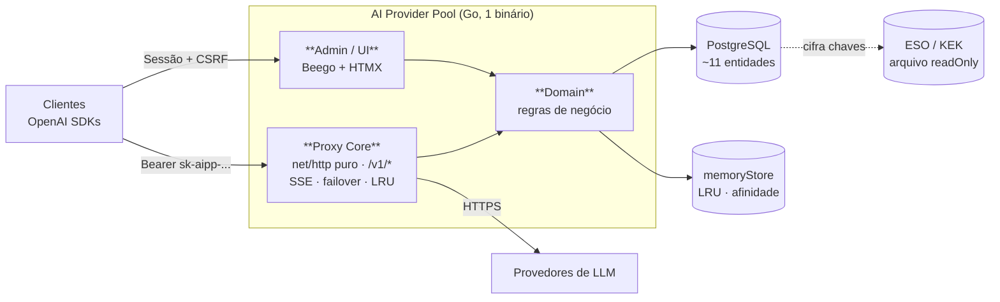
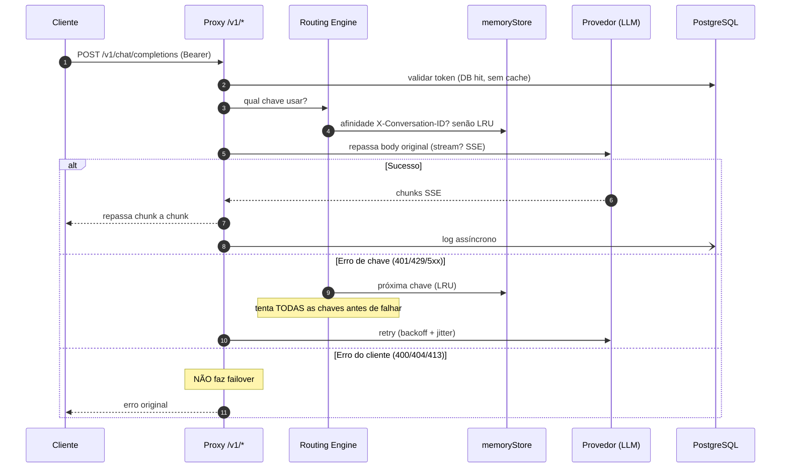

# Overview: AI Provider Pool - OpenAI-Compatible Proxy

**Generated at:** 2026-06-25T21:41:03.554Z
**Technical specification:** /home/rafael/devel/ai-pool/.mesa/specifications/spec-388d67e6.md

# Visão Geral — AI Provider Pool

> **Leia em 7 minutos.** Visão geral humana da especificação técnica. Para o detalhe autoritativo, consulte a [especificação completa](spec-388d67e6.md).

## Por que este projeto existe

A equipe acessa provedores de IA (Gemini, Mistral, DeepSeek, Z.ai, Kimi) de forma caótica: cada um usa a própria chave, saldos ficam ociosos em algumas contas enquanto outras esgotam, e o remédio para compartilhar chaves foi trocá-las pelo Telegram — sem auditoria nem governança.

O **AI Provider Pool** é **uma única porta de entrada** (compatível com a API OpenAI) que:

- **distribui a carga** entre todas as chaves habilitadas de um provedor;
- **falha de forma transparente** — se uma chave dá erro, tenta a próxima;
- **aproveita o cache de contexto** dos LLMs roteando conversas contínuas para a mesma chave (economia real de tokens);
- **desliga e reativa chaves sozinho**, lendo a data de liberação de cota na mensagem de erro do provedor;
- **governa quem pode o quê** com tokens por usuário, RBAC e auditoria.

**Escala-alvo do MVP:** ~30 usuários internos, ~5 provedores, 1-5 chaves por provedor. Sem SLA comercial.

---

## Panorama da arquitetura

**Três blocos, três responsabilidades.** O binário único de Go separa o **proxy** (HTTP puro, otimizado para streaming) da **admin/UI** (Beego, otimizada para CRUD), compartilhando apenas o domínio e o banco. Chaves de provedor são cifradas com AES-256-GCM no banco, com chave-mestra (KEK) externa injetada como **arquivo `readOnly`** — nunca como variável de ambiente.

---

## Como uma requisição atravessa o proxy

O proxy **preserva os bytes originais do corpo** e decide roteamento lendo o payload parcialmente. Para SSE há **três timeouts** (primeiro byte, ociosidade entre chunks, total) e cancelamento rigoroso do contexto: se o cliente desconecta, o pedido upstream é cancelado para poupar tokens.

> **Regra crítica:** uma vez enviado o primeiro chunk útil do stream, **não há mais failover** — não dá para trocar de chave no meio da resposta.

---

## Decisões que importam (e por quê)

### 1. Uma única réplica em produção — e está tudo bem

O MVP roda **`replicas: 1`** e **memória local** (sem Redis). Isso elimina uma classe inteira de bugs de estado distribuído (rate-limit ×N, afinidade fragmentada, invalidação de cache). Zero-downtime planejado via `RollingUpdate` + graceful shutdown.

**Risco aceito:** segundos de restart em falha não-planejada, sem HA.

**Quando migrar:** as abstrações de store já existem no MVP — basta adicionar implementação Redis quando surgir SLA duro, >50 RPS, quotas distribuídas ou multi-tenancy real. **Não importar `go-redis` agora.**

### 2. Afinidade de cache de contexto — o diferencial do produto

Provedores cobram tokens do histórico que poderiam estar em cache se a mesma chave fosse reutilizada. O pool resolve:

- **Preferencial:** header opt-in `X-Conversation-ID` → mesma chave.
- **Fallback:** hash SHA-256 do prefixo das mensagens (o array anterior é prefixo estrito do atual).
- Store por usuário, TTL 30 min, LRU eviction. **Tudo em memória, best-effort.**

> O hash de afinidade **jamais aparece em logs/métricas/traces** e não é persistido. O `X-Conversation-ID` é preferido porque não deriva do conteúdo.

### 3. O proxy não usa o framework web do admin

O Beego pode **bufferizar** e quebrar o streaming SSE. Por isso o proxy core é **HTTP puro com `http.Flusher`**, fora do Beego — que fica isolado na admin/UI.

### 4. Auto-disable inteligente (com parse de data)

Quando uma chave acumula N erros numa janela, é desabilitada. O diferencial: **lê-se a data de liberação de cota na mensagem de erro do provedor**, agenda-se reativação (`disabled_until`) + scheduler com `FOR UPDATE SKIP LOCKED`. Registry extensível por provedor (`ErrorParser` + fallback regex); se o parse falhar, a chave entra em backoff crescente em vez de travar o pool.

### 5. Segurança: o sistema é um cofre com API

- **Chaves de provedor** cifradas com AES-256-GCM; KEK externo como arquivo `readOnly`.
- **Tokens de usuário** (`sk-aipp-...`) com **HMAC-SHA256 + pepper** (não Argon2) — lookup O(1) e alta entropia dispensam hash lento.
- **Validação de token por DB hit a cada request, sem cache positivo** — revogação instantânea e determinística.
- **Duas cadeias de auth segregadas:** Bearer (proxy) vs Sessão httpOnly + CSRF (admin). Sem JWT em localStorage.
- **SanitizingLogger** centraliza redação de chaves; prefixo `sk-aipp-` registrado no GitHub Secret Scanning.

### 6. Frontend server-rendered, não SPA

Beego templates + HTMX + ECharts via `//go:embed` num binário único. Para 30 usuários internos em UI de CRUD, reduz superfície de ataque, evita toolchain Node e simplifica o Helm chart. **O estado fica no PostgreSQL.**

---

## Riscos aceitos e mitigados

| Risco | Mitigação |
|-------|-----------|
| Beego quebra SSE | Proxy core em HTTP puro fora do Beego |
| Restart perde estado em memória | Aceito no MVP; abstrações prontas para Redis; afinidade é best-effort |
| Parser de erro quebra ao mudar formato | Registry extensível + fallback genérico; falha → backoff (não trava) |
| Goroutine leak em streaming | Cancelamento de contexto rigoroso + timeouts |
| Vazamento de chave em logs | `SanitizingLogger` com redação centralizada |
| Perda de logs de uso em crash | WAL + dead-letter em INSERTs; perda máx ~25-50 logs aceitável |

---

## Decisões pendentes (precisam de você)

1. **Valores padrão do failover/backoff** — base delay, cap, janela de N erros para auto-disable.
2. **Provedor de DB em produção** — default é **managed DB** (CloudSQL/RDS com backup + PITR **inegociável**); CNPG só como exceção on-prem. Confirmar qual.
3. **Retenção de `usage_logs`** — DROP de partição sugerido em 90 dias. Definir política LGPD real.
4. **Política de rotação do KEK** — `encryption_key_id` prevê rotação, mas o cadenciamento não está definido.
5. **Particionamento automático** — `pg_partman` vs CronJob Kubernetes.
6. **Thresholds de rate-limit** — algoritmo é token bucket; limites concretos (req/min) por usuário/token.
7. **Quem é o "tenant default"** — a org `id=1` existe, mas faltam nome, Owners e processo de onboarding dos usuários reais.

---

## Onde estamos no plano

**11 fases** com marcos de demonstração: estrutura compilando → DB pronto → **streaming funcionando** → auth → **failover/reativação funcionando** → controles de uso → security hardening → **UI usável** → **MVP usável pela equipe** → deploy produção → entrega completa.

As fases críticas para validar o produto estão em **F3 (streaming), F5 (failover + afinidade + auto-disable) e F9 (MVP usável)**.

> **Próximo passo recomendado:** validar os itens pendentes acima antes de iniciar a F1 — especialmente provedor de DB e thresholds de failover, que reverberam em várias fases.
