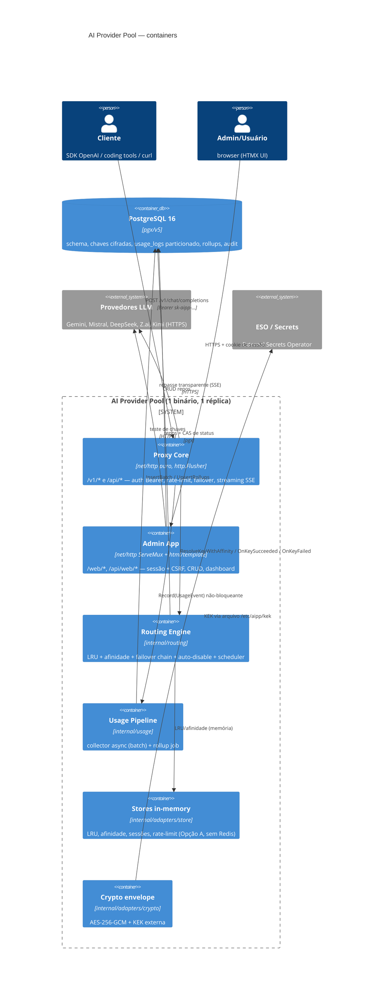

# Arquitetura — AI Provider Pool

> Criado em: 2026-08-13 · Última revisão: 2026-08-13
> Regra: doc desatualizado é corrigido ou marcado como obsoleto — nunca deixado apodrecendo em silêncio.
> Documento vivo de referência: descreve **como o produto é hoje**. Decisões e seus
> motivos vivem em `decisions/` (ADRs).

**O que é:** proxy/load-balancer de LLMs compatível com a API OpenAI. Cadastra múltiplas chaves
de provedores (Gemini, Mistral, DeepSeek, Z.ai, Kimi…) e distribui requisições entre elas com
balanceamento LRU, failover transparente, afinidade de cache de contexto, auto-disable/reativação
de chaves, governança (usuários, tokens `sk-aipp-...`, RBAC) e auditoria. Interface admin
server-rendered (Go `html/template` + HTMX + Alpine.js + ECharts).

**Stack:** Go 1.26 (`net/http` puro no hot path; Beego apenas como placeholder residual),
PostgreSQL 16 (pgx/v5 + pgxpool), golang-migrate, Prometheus client, Argon2id. Deploy:
Dockerfile multi-stage (distroless) + Helm chart com PostgreSQL nativo.

## 1. Visão geral — arquitetura hexagonal

O código segue Ports & Adapters estrito (ADR-0003): `internal/domain` não importa transporte nem
infraestrutura (ver `internal/domain/doc.go`); toda dependência externa entra via interface
definida no domínio (ou porta mínima local no pacote consumidor) e é composta no `cmd/aipp/main.go`.



Pontos estruturais:

- **Um único `http.Server`** com `composeHandler` (cmd/aipp/main.go:794) que roteia por
  precedência de path: `/api/web/*` → admin (antes do prefixo `/api/` do proxy), depois
  proxy (`/healthz`, `/readyz`, `/metrics`, `/v1/*`, `/api/*`), depois admin UI
  (`/web/*`, `/static/*`, `/invite/*`, `/`), e por último um Beego placeholder residual.
- **Beego é vestigial**: `web.Router("/", &placeholderBeegoController{})` e `conf/app.conf`
  existem apenas para compat; nenhuma rota real usa Beego. Todo o tráfego real é net/http puro.
- **Single-replica por design** (ADR-0001): todos os stores são in-memory; a troca futura por
  Redis é pavimentada pelas portas (`domain.LRUStore`, `AffinityStore`, `SessionStore`,
  `RateLimiter`) sem tocar o hot path.

## 2. Mapa de módulos

| Módulo (path) | Responsabilidade | Dependências-chave |
|---|---|---|
| `cmd/aipp` | Entrypoint: config, composição de adapters, subcomandos CLI (`--migrate-only`, `--bootstrap-admin-username`), graceful shutdown, background jobs | todos os `internal/*` |
| `internal/config` | Config 12-factor via env vars; validação dev/prod (prod exige `DATABASE_URL`, `KEK_PATH`, pepper, `SSRF_ALLOW_HTTP=false`) | stdlib |
| `internal/domain` | Entidades (User, APIToken, Provider, ProviderKey, Model), portas (stores, validators, engine, crypto), erros sentinelas, SSRF guard, Argon2id, tokens `sk-aipp-`, convites, sessões | stdlib + argon2id |
| `internal/routing` | RoutingEngine (LRU+afinidade), FailoverChain (stateful, backoff exponencial com full jitter via crypto/rand), AutoDisableManager (threshold 5 erros/2min, backoff crescente), ParserRegistry (extrai data de liberação de cota), ReactivationScheduler (tick 30s) | domain, observability |
| `internal/usage` | Collector assíncrono (canal 10k, batch 100, flush 1s, dead-letter), parser de `usage` do provedor (non-stream + SSE), RollupJob (agrega última hora a cada 1min) | domain, postgres |
| `internal/observability` | Métricas Prometheus (`aipp_*`), helpers únicos com sanitizers de label | prometheus/client_golang |
| `internal/adapters/httpserver/proxy` | Proxy Core: auth middleware (DB hit), parse parcial do body, forwarder (bytes originais, allowlist de headers, strip de prefixo `/v1`/`/api`), streaming SSE com 3 timeouts, erros formato OpenAI, registro de uso | domain, config, observability |
| `internal/adapters/httpserver/failover` | ChainWrapper: integra routing.FailoverChain ao proxy.Server sem import cíclico; computa conversationKey (X-Session-Id/X-Conversation-ID ou hash SHA-256 do prefixo) | proxy, routing |
| `internal/adapters/httpserver/admin` | UI + API admin: sessões (cookie httpOnly + CSRF double-submit), RBAC (role admin/user), CRUD completo, convites, teste de chaves, dashboard/auditoria JSON, templates | postgres, domain |
| `internal/adapters/postgres` | Pool pgx, migrations (golang-migrate + embed.FS), 10 repositórios (`*_repo.go`), TokenValidator (HMAC+pepper, constant-time), KeyResolver, adapters de portas do routing (`routing_adapters.go`) | pgx/v5, golang-migrate |
| `internal/adapters/store` | Implementações in-memory: LRU (com dirty-tracking + flush debounce 60s), afinidade (TTL 30min, LRU eviction), sessões (12h), rate-limit (x/time/rate), IdentityDecryptor (dev) | domain, x/time |
| `internal/adapters/crypto` | Envelope encryption AES-256-GCM: map KEK por `encryption_key_id` (rotação), formato `nonce‖ciphertext‖tag`, `LoadKEKFromFile` (32 bytes raw) | stdlib crypto |
| `internal/adapters/security` | `SanitizingHandler` (slog): redação por nome de atributo + regexes de secrets (tokens sk-aipp, Bearer, AWS/Google keys, Authorization) | stdlib slog |
| `migrations/` | Fonte de verdade do schema (4 pares up/down), embed.FS | golang-migrate |
| `web/` | Templates (8+ telas) + CSS ITCSS/BEM via embed.FS; JS libs via CDN com SRI | html/template |
| `deploy/helm/ai-pool` | Chart completo: app Deployment, PostgreSQL StatefulSet nativo, migration Job hook, ESO, Ingress (annotations SSE), NetworkPolicy | Helm v3 |

## 3. Fluxo de uma requisição de proxy

```mermaid
sequenceDiagram
    autonumber
    participant C as Cliente
    participant P as proxy.Server
    participant TV as TokenValidator (DB)
    participant RL as RateLimiter (mem)
    participant FW as failover.ChainWrapper
    participant FC as routing.FailoverChain
    participant E as RoutingEngine
    participant U as Upstream (provedor)
    participant UC as usage.Collector
    participant DB as PostgreSQL

    C->>P: POST /v1/chat/completions (Bearer sk-aipp-...)
    P->>TV: Validate(token) — DB hit por request<br/>(key_id lookup → HMAC constant-time → user ativo?)
    TV-->>P: user + token (401 genérico se inválido)
    P->>P: lê body (MaxBytesReader, 413 se exceder),<br/>parse parcial {model, stream}
    P->>RL: Allow("token:<id>") — 429 + Retry-After se excedido<br/>(registrado no usage_log com error_class=rate_limit)
    P->>FW: ExecuteProxyRequest(ctx c/ overall timeout)
    FW->>FW: conversationKey = X-Session-Id | X-Conversation-ID<br/>| hash SHA-256 do prefixo das mensagens
    loop até sucesso ou esgotamento
        FC->>E: ResolveKeyWithAffinity(model, convKey, exclude=triedKeys)
        E->>DB: reativação lazy de chaves expiradas +<br/>provider por model + chaves usable
        E->>E: afinidade? → senão LRU (PickLeastUsed) → decrypt AES-GCM
        FC->>U: request (auth trocada, body ORIGINAL, UA override)
        alt 2xx
            U-->>C: resposta (copy ou streaming SSE; commit)
            FC->>E: OnKeySucceeded (LRU MarkUsed + afinidade Remember + reset contador)
            FC->>UC: RecordProxyUsage(tokens, latência, provider/key)
        else 400/404/413 (erro do cliente)
            U-->>C: repassado sem failover
        else 401/403/429/5xx/rede (retryable)
            FC->>E: OnKeyFailed → AutoDisableManager.RecordError
            Note over E,DB: ≥5 erros/2min → CAS status=auto_disabled<br/>disabled_until = data parseada do erro<br/>ou backoff crescente (1m→24h)
            FC->>FC: triedKeys += key; backoff full-jitter; próxima chave
        end
    end
    UC-->>DB: batch insert usage_logs (async; falha → dead-letter)
    Note over DB: RollupJob (1min) agrega usage_logs → usage_rollups<br/>ReactivationScheduler (30s) reativa chaves cujo disabled_until passou
```

Invariantes importantes:
- **Body nunca é re-serializado** — os bytes exatos do cliente vão ao upstream (preserva cache
  de contexto e compatibilidade com campos desconhecidos).
- **"Committed"**: após o primeiro byte útil escrito ao cliente, não há mais failover;
  erro posterior é terminal (`ErrFailoverAborted`).
- **Erros do provedor não-2xx são repassados no formato original**; só erros do proxy usam o
  envelope OpenAI (`internal/adapters/httpserver/proxy/errors.go`).
- Resposta traz header `X-Context-Cache: HIT|MISS` (afinidade vs LRU).
- O flusher persiste `last_used_at` das chaves "dirty" no DB a cada 60s (debounce), e o boot
  faz seed do LRU a partir do DB — o ranking LRU sobrevive a restarts (main.go:699-728).

## 4. Persistência

Tabelas (migrations `202606252100` + 3 incrementais):

| Tabela | Papel | Notas |
|---|---|---|
| `organizations` | tenant (MVP: só id=1) | seed no init |
| `users` | usuários admin/user | Argon2id; soft-disable (`status`+`disabled_at`); sem DELETE físico |
| `api_tokens` | tokens `sk-aipp-[key_id8]-[secret48]` | só `key_id` + `token_hmac` (HMAC-SHA256+pepper); partial unique index por `key_id` entre ativos |
| `providers` | provedores LLM | `base_url` validada por SSRF guard; `api_spec` pavimenta parsers |
| `provider_keys` | chaves de provedores (ativo mais sensível) | `encrypted_value` AES-256-GCM; máquina de estados `enabled/auto_disabled/manual_disabled`; `disabled_until`, contadores de erro, `version` (lock otimista) |
| `models` | modelos por provedor | `context_window`, `output_limit`, `modalities`, `model_aliases`/`model_pricing` JSONB |
| `rate_limits` | **configuração** de rate limit | contagem fica em memória (x/time/rate), nunca no DB por request |
| `usage_logs` | log por requisição | **PARTITION BY RANGE (created_at)**, mensal |
| `usage_rollups` | agregação horária p/ dashboard | tabela física com upsert incremental (ON CONFLICT); PK composta (org,user,provider,model,bucket_hour) |
| `audit_log` | auditoria append-only | sem FK física; GRANTs de append-only são responsabilidade de IaC (comentado na migration, não aplicado) |
| `usage_logs_dead_letter` | retrabalho de inserts falhos | complementa o collector |
| `invitation_tokens` | convites de uso único | só hash SHA-256; FK ON DELETE SET NULL (migration 202607070000) |

**Particionamento de `usage_logs`:** partições mensais. A migration inicial pré-cria
2026-06 a 2026-09 + partição `DEFAULT` (catch-all; INSERT fora de partição cai ali — sinal de
alerta operacional). **Não existe automação de criação de partições futuras nem de retenção
(90d)**: os métodos `EnsureFuturePartitions`/`DropOldPartitions` estão como comentários-stub
em `internal/adapters/postgres/usage_repo.go:687-695` e não há CronJob no chart Helm.
Sem partição futura, inserts do mês seguinte caem na DEFAULT (não falham, mas violam o design).

**Rollups:** `RollupJob` roda a cada 1 minuto agregando desde o início da hora anterior até
agora (upsert idempotente, então a hora corrente é atualizada incrementalmente para o
dashboard/"meu uso" ver dados recentes).

## 5. Cross-cutting

- **Criptografia envelope (KEK):** `provider_keys.encrypted_value` = `nonce(12)‖ciphertext‖tag`
  AES-256-GCM. KEK de 32 bytes raw carregada de arquivo (`KEK_PATH`, montado readOnly via
  Secret/ESO — nunca env var, nunca no DB). `encryption_key_id` (default `v1`) suporta rotação
  gradual (map de KEKs em `AESGCMCrypto`). Em dev sem KEK: `IdentityDecryptor` (plaintext) com
  warning loud. Valor decifrado vive só na request e é zeroizado (`defer zeroBytes`).
- **Tokens de API:** valor completo só existe na geração; DB guarda `key_id` público +
  `token_hmac` (HMAC-SHA256 com pepper ≥32B; pepper via arquivo em prod). Validação com DB hit
  por request + comparação constant-time → revogação imediata.
- **Sessões admin:** server-side, in-memory (TTL absoluto 12h), cookie `aipp_sess` httpOnly +
  `aipp_csrf` (não-httpOnly) com CSRF double-submit + comparação contra o token da sessão.
  Login com Argon2id + timing equalization (fake hash) + rate-limit por IP. Segregado do Bearer
  do proxy. Pipeline: `csrf → sessionAuth → requireRole` (ordem importa — ver comentário do
  bug F9 em `admin.go:326-332`).
- **Rate limiting:** token bucket in-memory (x/time/rate) por escopo `token:<id>` (proxy) e
  `login_ip:<ip>` (login). Defaults: burst 10, 60 req/min.
- **Observabilidade:** logs JSON estruturados via slog com `SanitizingHandler` global
  (redação por nome de atributo e por regex — `sk-aipp-*`, Bearer, Authorization etc.).
  Métricas Prometheus sempre instrumentadas (`aipp_proxy_requests_total`,
  `aipp_proxy_request_duration_seconds`, `aipp_failover_attempts_total`, `aipp_tokens_total`,
  `aipp_keys_disabled_total`, `aipp_key_reactivations_total`); endpoint `/metrics` **gateado**
  por `ENABLE_METRICS` (default false). Helpers públicos com sanitizers de label
  (`unknown` para vazio) evitam explosão de cardinalidade.
- **SSRF guard:** `domain.ValidateProviderURL` no cadastro de providers — scheme http(s),
  blocklist de loopback/RFC1918/link-local (inclui 169.254.169.254)/multicast; resolve DNS e
  rejeita se **qualquer** IP for bloqueado. Em prod `http://` é proibido (config.Validate).

## 6. Deploy

- **Dockerfile multi-stage:** builder `golang:1.26.6-alpine` (cache de `go mod download`,
  `CGO_ENABLED=0`, `-trimpath -ldflags "-s -w"`) → runtime `gcr.io/distroless/base-debian12:nonroot`
  (UID 65532, CA roots para HTTPS aos provedores — deliberadamente não é `static`). Migrations e
  assets web vão embutidos via `//go:embed` — nenhum arquivo solto na imagem.
- **Helm chart (`deploy/helm/ai-pool`, v0.2.0):** PostgreSQL como templates **nativos**
  (StatefulSet + PVC + Service + Secret, imagem oficial `postgres:16-alpine`; senha auto-gerada
  e persistida via `lookup`; `helm.sh/resource-policy: keep` no PVC). App Deployment com
  RollingUpdate maxSurge 1/maxUnavailable 0, securityContext endurecido (runAsNonRoot,
  readOnlyRootFilesystem, drop ALL caps, seccomp), probes startup/liveness (`/healthz`)/
  readiness (`/readyz`), KEK+pepper montados como arquivos `0400` em `/etc/aipp`,
  checksums de config/secret como annotations para rollout. Ingress com annotations SSE
  críticas (`proxy-buffering: off`, timeouts 3600s). NetworkPolicy deny-all opcional.
  ESO opcional (2 ExternalSecrets: DATABASE_URL e app-secrets).
- **Migrations como Job hook:** Job `post-install,post-upgrade` (weight -5,
  `before-hook-creation`) com init container `wait-for-db` (pg_isready) e container rodando
  `aipp --migrate-only` (migrations do embed.FS; golang-migrate com advisory lock — idempotente
  e concurrency-safe). Falha no Job marca o release como FAILED. Em `DEV_MODE=true` as
  migrations rodam no startup do app (dev apenas). Bootstrap admin via CLI
  `aipp --bootstrap-admin-username=...` (idempotente, senha ≥12 chars, env preferida a flag).
- **CronJob de partições: NÃO EXISTE** — dívida operacional crítica (ver §7).
- **CI (`.github/workflows/ci.yml`):** gates lint-test (vet, gofmt, test -race), security
  (gosec, govulncheck), docker (build + trivy HIGH/CRITICAL), helm (lint + template em 2
  cenários) → release para GHCR (`ghcr.io/hacklabr/ai-pool`) via OIDC (push main = tag
  sha-curto; tag `v*` = semver + latest) → deploy-dev (main) / deploy-prod (tags) via
  `helm upgrade --install`.

## 7. Pontos de atenção / dívidas técnicas

1. **Gestão de partições ausente (crítico).** Sem CronJob/job de pré-criação nem retenção:
   `internal/adapters/postgres/usage_repo.go:687-695` (stubs `EnsureFuturePartitions`,
   `DropOldPartitions`, `ReprocessDeadLetter`); ausência de template CronJob em
   `deploy/helm/ai-pool/templates/`. Inserts de meses sem partição caem silenciosamente em
   `usage_logs_default`.
2. **Auditoria com cobertura parcial.** `auditRepo.Append` só é chamado em convites
   (`admin/invite.go:134`, `admin/invitations.go:103,172,206`). CRUDs de users/providers/
   keys/models/tokens **não** gravam em `audit_log`, embora a tela de auditoria exista.
3. **Rate-limit do login não usa o limite configurado.** `main.go:173` chama
   `SetLimit("login_ip:_default", 10, 10)`, mas o handler usa escopo `"login_ip:"+ip`
   (`admin/login.go:110`) — buckets por IP herdam os defaults globais (burst 10, 60/min),
   não os 10/min pretendidos.
4. **Fail-open no decryptor em produção.** `buildDecryptor` (main.go:733-750): se a KEK falha
   ao carregar, faz fallback para `IdentityDecryptor` com apenas `logger.Error` — em prod o
   correto seria falhar o startup. Idem `buildEncryptor` retornando nil silenciosamente.
5. **providerSlug vazio no failover.** `failover/wrapper.go:89` passa `providerSlug := ""` ao
   chain, então o ParserRegistry sempre cai no `DefaultErrorParser` e a métrica
   `aipp_failover_attempts_total` fica com label `provider="unknown"`.
6. **Caminho de produção não grava `token_id` em usage_logs.** `RecordProxyUsage`
   (proxy/usage.go:90-126) omite o token — `token_id=0` em todos os registros do caminho
   failover; o campo vira inútil para auditoria por token.
7. **`/readyz` não checa dependências.** `proxy/server.go:179-183` retorna sempre 200;
   comentários no values.yaml e em `db.go` afirmam que readiness checa DB — divergência
   doc/implementação.
8. **Documentação do hook de migrations desatualizada.** `values.yaml:10,350` e
   `migrations/README.md:21` dizem "pre-install/pre-upgrade"; o template foi corrigido para
   `post-install,post-upgrade` (migration-job.yaml:1-36).
9. **Beego residual.** Placeholder controller + `conf/app.conf` sem rotas reais — dependência
   e superfície sem função (composeHandler passo 4, main.go:820-821).
10. **Encryptor/Decryptor duplicados.** `buildEncryptor` e `buildDecryptor` constroem duas
    instâncias independentes de `AESGCMCrypto` com a mesma KEK (main.go:755-770) — rotação
    futura teria que atualizar ambas.
11. **Perda silenciosa aceita em dead-letter.** Se o InsertDeadLetter também falha, o erro é
    descartado (`_ = dlErr`, usage/collector.go:179-183).
12. **Estado volátil por design (single-réplica).** LRU, afinidade, sessões e rate-limits se
    perdem em restart (LRU mitigado por seed/flusher; sessões exigem re-login; contadores do
    auto-disable zeram). ROADMAP prevê Redis (Opção B) para ≥2 réplicas.
13. **Comentários mistos em chinês** em `cmd/aipp/main.go:337` e
    `internal/routing/auto_disable.go:36` — resíduo de geração, fora do padrão PT-BR.
